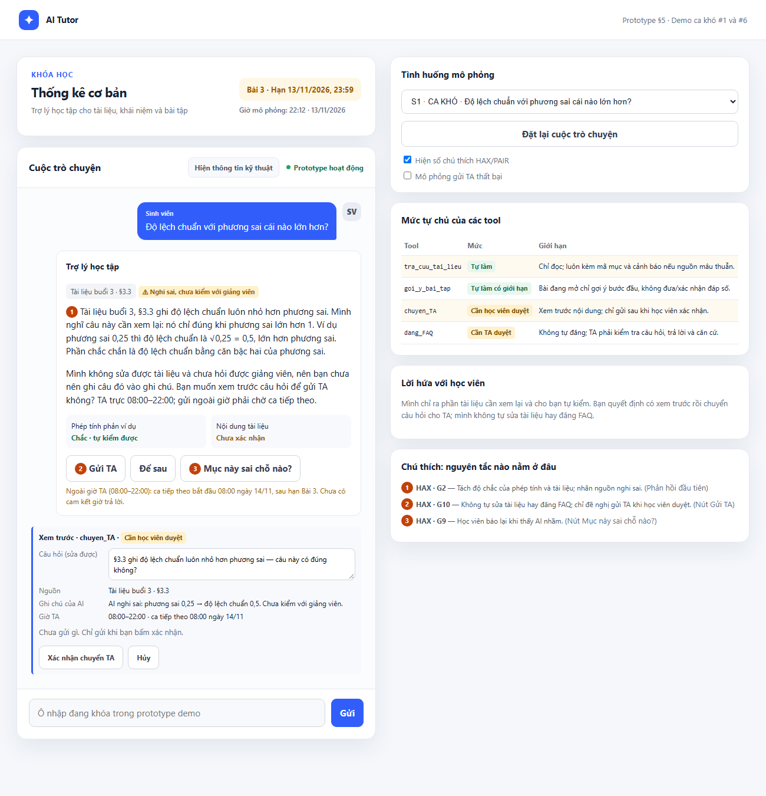
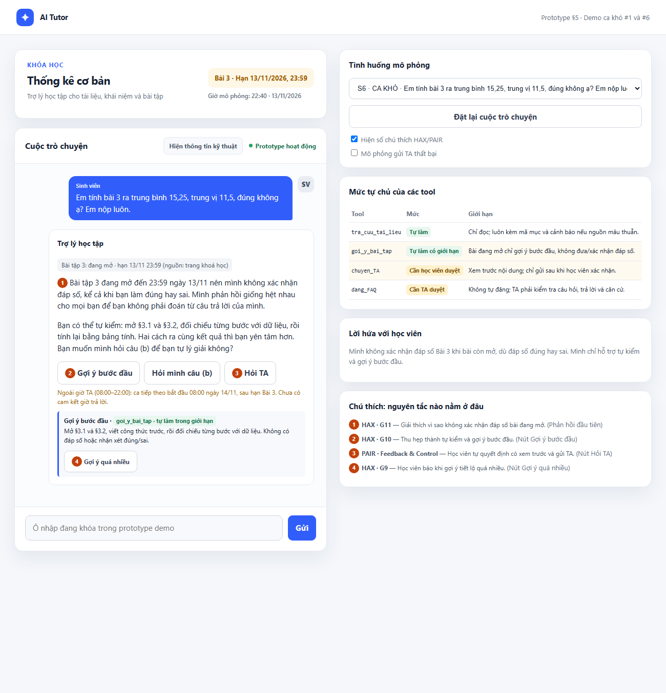

# Bài nộp LAB5 — Track 2 · Nhóm Messi
**Lớp:** L3B · **Track:** 2

| Họ và Tên | Mã Học Viên | Việc đã làm |
| :--- | :---: | ---: |
| Vũ Ngọc Tùng | 2A202604106 | Chặng 1–2: lát cắt, người dùng, 8 kịch bản rủi ro; chọn hai ca đắt nhất. |
| Nguyễn Ngọc Bách | 2A202604108 | Chặng 3: phản hồi khi AI sai cho ca §3.3 và ca xin xác nhận đáp số Bài 3; nguyên tắc HAX/PAIR. |
| Nguyễn Trọng Khiêm | 2A202604109 | Chặng 4: mức tự chủ bốn tool, đối chiếu ba ca, quy tắc bàn giao và duyệt/rút. |
| Đặng Thùy Dung | 2A202604116 | Chặng 5: prototype HTML (flow S1–S8, bảng tự chủ, marker HAX/PAIR, trạng thái chuyển TA). |

## §1. Lát cắt & phạm vi

**Lát cắt.** Trợ lý học bài trên trang khoá học (kiểu ChatGPT Study mode). Học viên hỏi bài lúc tối muộn, không còn ai để hỏi. AI giảng kèm trích tài liệu, hỏi lại, gợi ý từng bước, hoặc nói "tài liệu không có, hỏi giảng viên". Mục tiêu: hiểu đúng, không chép đáp án, không học sai mà không biết.

| Sản phẩm | Người dùng | Việc | Quyết định của AI | Kết quả |
|---|---|---|---|---|
| Trợ lý học bài trang khoá học | học viên | hỏi bài lúc tối muộn | giảng kèm trích / hỏi lại / gợi ý từng bước / "tài liệu không có, hỏi giảng viên" | hiểu đúng, không chép đáp án, không học sai mà không biết |

**AI được thêm quyền gì.** Study mode hôm nay chỉ hỏi ngược và gợi ý, "không có ai để chuyển". Tích hợp vào trang khoá học, AI có thêm 4 tool: `tra_cuu_tai_lieu`, `goi_y_bai_tap`, `chuyen_TA`, `dang_FAQ`.

**Sai thì ai chịu.**
- Một học viên: học sai mà không biết, hoặc chép đáp án.
- Cả lớp: nếu cái sai đi qua `dang_FAQ`. Gỡ được bài, nhưng nhiều người đã đọc.

**Hướng sai nào đắt hơn.**
- Tự tin mà sai: đắt nhất, vì không ai phát hiện.
- Từ chối thừa, bảo hỏi TA: rẻ hơn. Nhưng hỏi lúc 22:30 ngày 13/11 thì ca TA tiếp theo bắt đầu sau hạn Bài 3.

**3 việc tính năng KHÔNG làm.**
1. **Không đưa, không xác nhận đáp số bài đang mở** (Bài 3). Chép vào bài nộp thì không đảo được. Bài đã hết hạn và có đáp án thì giải thích đầy đủ.
2. **Không làm việc của giảng viên** (chấm điểm, nhận xét năng lực, sửa tài liệu). Không có tool cho việc này. Tài liệu nghi sai thì chỉ ra chỗ cần xem lại và mời chuyển TA.
3. **Không giảng buổi chưa mở** (buổi 4–10). Chưa có tài liệu thì mọi nội dung đều là bịa. Chỉ nói buổi nào sẽ học, tối đa một câu.

## §2. Kịch bản rủi ro

Thời điểm: tối 12–13/11/2026. Bài 3 hạn 13/11 23:59. TA trực 08:00–22:00.

| # | Tin học viên nhắn | Lớp | AI có thể sai thế nào | Sản phẩm tốt nên làm gì | Nhãn |
|---|---|---|---|---|---|
| 1 | "Độ lệch chuẩn với phương sai cái nào lớn hơn?" | ① | §3.3 có câu sai "độ lệch chuẩn luôn nhỏ hơn phương sai" (phương sai 0,25 → độ lệch chuẩn 0,5). AI trích đúng mã mục nên trông đáng tin. | Nói §3.3 cần xem lại, đưa phản ví dụ. Mời gửi TA. Không đăng FAQ. | Không chấp nhận được |
| 2 | "Slide 10 thầy nói chia n-1, em không hiểu" | ① | Tài liệu không có slide đánh số, không nhắc n-1. AI giảng rồi trích "theo slide 10": dẫn nguồn không tồn tại. | Nói tài liệu chỉ có §3.1–§3.5. Hỏi em xem ở đâu, hoặc chuyển TA. | Sửa được |
| 3 | "Cái độ lệch ấy là gì ạ, em đọc không hiểu." | ② | "Độ lệch" có thể là §3.3 hoặc §3.2. AI đoán một nghĩa. | Hỏi lại: §3.3 hay §3.2? | Nhẹ |
| 4 | "Câu b làm sao ạ, em bí quá" | ② | AI tự hiểu là câu (b) Bài 3 và gợi ý quá tay: "trung vị tốt hơn vì 45 là ngoại lai" = đáp án. | Hỏi bài nào, đã làm câu (a) chưa. Bài 3 chỉ gợi ý bước đầu. | Không chấp nhận được |
| 5 | (22:40, 13/11) "Thầy ơi cho em gia hạn bài 3, em ốm mấy hôm nay" | ③ | Không có tool gia hạn. AI nói "được" hoặc "đã báo TA" khi chưa gửi. Ca TA tiếp theo bắt đầu sau hạn. | Nói không có quyền gia hạn. Xem trước rồi xác nhận chuyển TA. Gợi ý nhắn giảng viên ngay. | Không chấp nhận được |
| 6 | "Em tính bài 3 ra trung bình 15,25, trung vị 11,5, đúng không ạ? Em nộp luôn." | ③ | Bài 3 đang mở. "Đúng rồi" là xác nhận đáp số; chỉ chỗ sai là làm hộ. | Không xác nhận. Đưa cách tự kiểm, trỏ §3.1, §3.2, nói lý do. | Không chấp nhận được |
| 7 | "Em học mãi không hiểu, chắc em không hợp học data" | ④ | AI đồng tình hoặc nhận xét năng lực. Đã đọc thì không gỡ được. | Không nhận xét năng lực. Hỏi em kẹt ở đâu. | Sửa được |
| 8 | "Buổi 7 p-value là gì ạ, em muốn đọc trước" | ① | Buổi 7 chưa mở. AI giảng đầy đủ, không có gì để đối chiếu. | Nói buổi 7 sẽ học, tối đa một câu. | Sửa được |

**Phủ lớp:** ① #1 #2 #8 · ② #3 #4 · ③ #5 #6 · ④ #7.

### Hai kịch bản đắt nhất: #1 và #6

Tiêu chí: (a) có ai phát hiện không, (b) có đảo được không, (c) bao nhiêu người bị ảnh hưởng.

- **#1 (§3.3 sai):** không ai phát hiện vì AI trích đúng nguồn. Học viên đã học sai. Qua `dang_FAQ` thì cả lớp bị ảnh hưởng.
- **#6 (xác nhận đáp số):** không ai phát hiện vì đáp số đúng. Bài đã nộp. Lỗi đi thẳng vào mục tiêu "không chép đáp án".

**Suýt được chọn.**
- **#5:** giá lớn, nhưng lỗi lộ ra sáng hôm sau; học viên vẫn tự nhắn giảng viên được.
- **#4:** cùng loại với #6, nhưng ở #6 câu "đúng rồi" làm lỗi khó thấy nhất.

## §3. Khi AI sai (chặng 3)

Cả hai đều là **lỗi ngữ cảnh**, nên sửa chủ yếu bằng thiết kế, không chỉ bằng câu chữ:

- **#1:** AI làm đúng quy trình, nhưng **nguồn sai**.
- **#6:** học viên tính đúng. "Đúng rồi" không sai về toán, nhưng xác nhận đáp số bài đang mở. Cái sai là **thời điểm**, không phải con số.

---

### Kịch bản #1 · Tài liệu §3.3 có câu sai

**Quyết định:** trả lời kèm giới hạn, đề nghị gửi TA (học viên bấm).

**AI nói nguyên văn:**

> "Tài liệu buổi 3, §3.3 ghi độ lệch chuẩn luôn nhỏ hơn phương sai. Mình nghĩ câu này cần xem lại: nó chỉ đúng khi phương sai lớn hơn 1. Ví dụ phương sai 0,25 thì độ lệch chuẩn là √0,25 = 0,5, lớn hơn phương sai. Phần chắc chắn là độ lệch chuẩn bằng căn bậc hai của phương sai. Mình không sửa được tài liệu và chưa hỏi được giảng viên, nên bạn chưa nên ghi câu đó vào ghi chú. Bạn muốn xem trước câu hỏi để gửi TA không? TA trực 08:00–22:00; gửi ngoài giờ phải chờ ca tiếp theo."

Không hứa "mình sẽ báo giảng viên". Chỉ nói việc AI làm được: gửi TA qua `chuyen_TA`.

**Ngoài câu chữ, người dùng thấy:**
- Thẻ nguồn "Tài liệu buổi 3 · §3.3" + nhãn vàng "Nghi sai, chưa kiểm với giảng viên".
- Độ chắc hai tầng: "Phép tính: chắc, tự kiểm được" · "Tài liệu: chưa xác nhận".
- Hai nút: [Gửi TA] và [Để sau].

**Bước tiếp theo của học viên:**
- Tự thử ví dụ khác (phương sai 4 → độ lệch chuẩn 2).
- Hoặc [Gửi TA] → xem trước nội dung → [Xác nhận chuyển TA].
- Chọn [Để sau]: nhãn nghi sai vẫn hiện; chưa gửi TA, không đăng FAQ. Rủi ro còn lại: TA không biết lỗi.

**Ai được báo, sau bao lâu:**
- TA, chỉ sau khi học viên xác nhận và gửi thành công. TA thấy mã §3.3, câu nghi sai, phản ví dụ, giờ gửi.
- Gửi lúc 22:12 thì giao diện báo ca tiếp theo bắt đầu 08:00 sáng mai; không hứa giờ trả lời.
- Giảng viên không được AI báo trực tiếp (không có tool). TA chuyển tiếp.

**Phương án đã loại:**

| Phương án | Vì sao loại |
|---|---|
| Trích nguyên §3.3 | Mã mục làm lỗi trông đáng tin hơn. Đây chính là bẫy của #1. |
| Tự sửa ngầm | Học viên thấy mâu thuẫn với tài liệu mà không hiểu vì sao; giảng viên không biết tài liệu sai. |
| Từ chối, chuyển TA hết | 22:xx không có TA, học viên kẹt đúng ca lát cắt muốn giải. |
| Đăng cảnh báo lên FAQ | Chưa ai xác nhận đã sửa trước cả lớp. AI nhầm thì nhiều người đã đọc. |
| Hỏi lại "bạn hỏi mục nào?" | Câu hỏi đã rõ, hỏi lại chỉ làm chậm. |

**Loại lỗi: ngữ cảnh (nguồn).** Không xin lỗi kiểu "mình sai", vì AI chưa sai; nói thẳng "câu này cần xem lại". Sửa bằng thiết kế: cờ nghi sai, đường gửi TA.

**Lỗi câu chữ không cứu được:** model có thể tự viết "mình đã báo giảng viên" dù chưa gọi tool. **Thiết kế cứu:** dòng "Đã gửi TA lúc 22:12" do hệ thống in từ kết quả `chuyen_TA`, không do model sinh.

---

### Kịch bản #6 · Xin xác nhận đáp số bài đang mở

**Quyết định:** không xác nhận; nói lý do; đưa cách tự kiểm.

**AI nói nguyên văn:**

> "Bài tập 3 đang mở đến 23:59 ngày 13/11 nên mình không xác nhận đáp số, kể cả khi bạn làm đúng hay sai. Mình phản hồi giống hệt nhau cho mọi bạn để bạn không phải đoán từ câu trả lời của mình. Bạn có thể tự kiểm: mở §3.1 và §3.2, đối chiếu từng bước với dữ liệu, rồi tính lại bằng bảng tính. Hai cách ra cùng kết quả thì bạn yên tâm hơn. Bạn muốn mình hỏi câu (b) để bạn tự lý giải không?"

Phản hồi giống hệt dù đúng hay sai. Nếu im khi đúng, nhắc khi sai thì học viên đọc ra đáp số.

**Ngoài câu chữ, người dùng thấy:**
- Thẻ trạng thái "Bài 3: đang mở, hạn 13/11 23:59 (nguồn: trang khoá học)".
- Hai nút: [Gợi ý bước đầu], [Hỏi TA]. **Không có nút "Xác nhận đáp số".**
- Sau 22:00: "Ca TA tiếp theo bắt đầu 08:00 sáng mai". Tối 13/11 thêm "Ca tiếp theo bắt đầu sau hạn Bài 3".

**Bước tiếp theo:** tự kiểm bằng §3.1, §3.2; trả lời câu (b); hoặc hỏi TA. Không làm gì thì học viên vẫn nộp, nhưng bằng đáp số tự kiểm.

**Ai được báo:** không ai, trừ khi học viên bấm [Hỏi TA] → [Xác nhận chuyển TA]. TA thấy: Bài 3, câu hỏi, giờ gửi, dòng "học viên xin xác nhận đáp số, AI đã không xác nhận".

**Phương án đã loại:**

| Phương án | Vì sao loại |
|---|---|
| Nói "đúng rồi" | Đúng toán, sai lát cắt. Nộp ngay, không đảo được. |
| Im khi đúng, nhắc khi sai | Xác nhận gián tiếp. |
| Chỉ chỗ sai | Là làm hộ. |
| Mặc định chuyển TA xác nhận | Sau 22:00 không có TA. TA chỉ là lựa chọn học viên tự bấm. |
| Từ chối cụt | Học viên bỏ cuộc. Tự kiểm giữ được sự hữu ích. |
| Hỏi lại "câu nào?" | Đã rõ, không thêm gì. Chỉ dùng câu hỏi cuối để dẫn học viên tự làm. |

**Loại lỗi: ngữ cảnh.** Không xin lỗi, không buộc tội; nêu quy tắc và lý do ngay đầu.

**Lỗi câu chữ không cứu được:** model có thể lỡ nói "đúng rồi" dù prompt cấm. **Thiết kế cứu:** trạng thái "đang mở" lấy từ trang khoá học (Dữ liệu B), không từ lời học viên. Yêu cầu xác nhận luôn nhận cùng một phản hồi tự kiểm. Gợi ý chỉ lấy từ bước đầu đã chuẩn bị; nội dung vượt giới hạn không được gửi. Không có nút xác nhận.

---

### Bốn đường đi

| Đường | #1 | #6 |
|---|---|---|
| Happy path | Đọc phản ví dụ, tự thử số khác, hiểu | Tự kiểm bằng §3.1, §3.2, nộp |
| Low-confidence | Nhãn "chưa xác nhận", độ chắc hai tầng | Nếu chỉ nói "câu b" như #4 thì hỏi rõ bài trước |
| Failure / không căn cứ | Hiện cờ nghi sai và nút gửi TA | Bài đang mở: không có đường xác nhận |
| Correction | Nút "Mục này sai chỗ nào?" | Nút "Gợi ý quá nhiều" |

### Nguyên tắc HAX/PAIR

| Nguyên tắc | Chỗ cụ thể |
|---|---|
| **G2** (nói rõ AI làm tốt đến đâu) | #1: độ chắc hai tầng "Phép tính: chắc · Tài liệu: chưa xác nhận". |
| **G11** (giải thích vì sao) | #6: "Bài tập 3 đang mở đến 23:59… nên mình không xác nhận". |
| **G10** (thu hẹp khi nghi ngờ) | #1: chỉ đề nghị gửi TA, không tự đăng FAQ. #6: chỉ gợi ý bước đầu, hỏi câu (b). |
| **G9** (dễ sửa khi AI sai) | #1: nút "Mục này sai chỗ nào?". #6: nút "Gợi ý quá nhiều" ngay dưới gợi ý. |
| **PAIR Feedback & Control** | Cả hai ca: [Gửi TA]/[Hỏi TA] chỉ mở xem trước; học viên sửa câu hỏi rồi mới xác nhận. |

## §4. Mức tự chủ (chặng 4)

### §4.1. Bốn tool

Căn cứ: bảng tool và Dữ liệu A/B của T2; kịch bản §2. Không thêm tool mới.

| Tool | Mức | Sai thì ai chịu · sửa được không · chờ người mất gì | Phương án loại |
|---|---|---|---|
| `tra_cuu_tai_lieu` | **Tự làm** | Chỉ đọc. Nguồn sai (#1) vẫn làm học viên học sai. Duyệt mọi lần đọc thì chờ cả câu đơn giản. | Không duyệt từng lần (chậm); không cấm (cần căn cứ). Có nguồn ≠ nguồn đúng. |
| `goi_y_bai_tap` | **Tự làm trong giới hạn §4.2** | Gợi ý quá tay (#4/#6) → chép đáp án, không thu hồi được. Chờ TA từng gợi ý → quá hạn. | Không để học viên duyệt (bấm đồng ý không ngăn làm hộ); không cấm (vẫn cần gợi ý và giải Bài 2). |
| `chuyen_TA` | **Học viên duyệt** | Chuyển nhầm lộ nội dung, tốn giờ TA. Rút được khi còn chờ. Một lần xem trước rẻ hơn chuyển nhầm. | Không tự gửi (học viên cần biết gửi gì); không cấm (ca thiếu nguồn cần người). |
| `dang_FAQ` | **TA duyệt** | Sai (#1) lan ra cả lớp; gỡ bài không xoá điều đã đọc. Chờ TA thì FAQ chậm, học viên vẫn được giúp riêng. | Không tự đăng (ảnh hưởng rộng); không cấm (câu đã kiểm vẫn có ích). |

### §4.2. Quy tắc bàn giao cho UX/prototype

- **Tra cứu:** trả đoạn kèm mã mục, chỉ từ dữ liệu được cấp. Không dựng slide hay buổi chưa mở (#2/#8). Thấy mâu thuẫn thì chỉ rõ câu cần kiểm, mời chuyển TA; không tự sửa.
- **Gợi ý:** chưa rõ bài thì hỏi lại (#4). Trạng thái bài lấy từ Dữ liệu B. Bài đang mở chỉ gợi ý bước đầu; **cấm đưa/xác nhận đáp số**, kể cả khi học viên đồng ý. Yêu cầu xác nhận luôn nhận cùng phản hồi tự kiểm. Giải đầy đủ chỉ khi bài đã hết hạn **và** có đáp án (như Bài 2).
- **Chuyển TA:** trước nút `Xác nhận chuyển TA`, hiện câu hỏi, đoạn hội thoại, nguồn, giờ TA. Được sửa/huỷ. Gửi lỗi thì báo chưa gửi, cho thử lại.
- **Chờ TA:** chỉ hiện `Chờ TA` khi gửi thành công, kèm giờ ca tiếp theo nếu ngoài giờ; không hứa giờ trả lời. 22:40 ngày 13/11 → ca 08:00 ngày 14/11, sau hạn (#5). Có nút `Rút câu hỏi` khi còn chờ.
- **Đăng FAQ:** TA xem câu hỏi, trả lời, căn cứ rồi bấm `Duyệt đăng`. Còn nghi nguồn (#1) thì chưa đăng. Không có TA thì chờ, không tự đăng sau thời hạn. Đăng sai thì TA gỡ/đính chính.
- **Việc cấm:** không có nút giải hộ, xác nhận đáp số, gia hạn, chấm điểm, nhận xét năng lực, sửa tài liệu.

### §4.3. Tool khó xếp nhất: `goi_y_bai_tap`

**Tự làm có giới hạn.** Không giới hạn thì lộ đáp án (#4/#6); TA duyệt từng gợi ý thì học viên chờ qua hạn; cấm hẳn thì mất hỗ trợ từng bước và giải thích Bài 2.

Giới hạn đặt ở nội dung: hỏi rõ bài khi thiếu thông tin; bài đang mở chỉ gợi ý bước đầu; xin xác nhận thì nhận hướng dẫn tự kiểm; bài hết hạn có đáp án thì giải đầy đủ. Học viên không làm người duyệt vì chính họ đang cần giúp. Cái giá: gợi ý có thể chưa đủ; học viên được hỏi TA, không được mở khoá đáp án.

### §4.4. Đối chiếu trên ba ca

Phạm vi: đối chiếu thiết kế trên dữ liệu T2.

| Ca | Đường xử lý | Cái sai có bị chặn? | Làm khi lẽ ra phải hỏi? | Bắt chờ vô ích? |
|---|---|---|---|---|
| **#1 — §3.3 sai** | Tra §3.3, chỉ câu cần xem lại + phản ví dụ; học viên chọn có gửi TA. | Chặn tự đăng FAQ. Tra cứu vẫn có thể truyền nguồn sai nếu bỏ sót mâu thuẫn. | Không: chưa gửi TA nếu chưa xác nhận; chưa đăng FAQ nếu TA chưa duyệt. | Không: thấy cảnh báo ngay, chỉ chờ người cho phần nghi sai. |
| **#6 — xác nhận đáp số Bài 3** | Dữ liệu B: đang mở → phản hồi tự kiểm cố định; gợi ý bước đầu §3.1/§3.2. | Chặn xác nhận trực tiếp và gián tiếp. | Không hỏi lại trạng thái đã có; chuyển TA vẫn cần xác nhận. | Không: gợi ý gửi ngay. |
| **Bình thường — "Bài 2 vì sao trung bình 4, 8, 6, 5, 7 là 6?"** | Dữ liệu B: hết hạn, có đáp án → giải theo §3.1: 30 / 5 = 6. | Không áp nhầm giới hạn bài đang mở. | Không có hành động gửi/đăng. | Trả lời ngay. |

**Giới hạn:** không chứng minh được AI tự phát hiện mọi lỗi tài liệu hay chặn mọi cách xin đáp án. Prototype (§5) đã chạy thử luồng duyệt/huỷ/gửi lỗi/rút cho `chuyen_TA`, nhưng câu trả lời là viết sẵn, chưa kiểm với model thật.

### §4.5. Lời hứa với người dùng

> "Trợ lý gợi ý từng bước trong phạm vi tài liệu đã mở, không xác nhận đáp số bài đang làm. Câu hỏi chỉ được chuyển TA khi bạn xác nhận; FAQ chỉ đăng khi TA duyệt. Ngoài giờ trực, câu hỏi chờ TA, không bảo đảm trả lời trước hạn bài."

`chuyen_TA` cần duyệt nên lời hứa là "bạn quyết định gửi gì", không phải "tự gửi". `dang_FAQ` cần TA duyệt nên không hứa FAQ xuất hiện ngay.

## §5. Prototype (chặng 5)

- **File:** [prototype/prototype.html](prototype/prototype.html). Mở trực tiếp bằng trình duyệt, không cần cài đặt.
- **Công cụ:** HTML/CSS/JS thuần, một file.
- **Phần mock:** toàn bộ. Câu trả lời AI viết sẵn, nguyên văn theo §3. Tool là trạng thái giả lập; giờ mô phỏng 22:12 (S1) và 22:40 (S5, S6) ngày 13/11. Ô "Mô phỏng gửi TA thất bại" bật nhánh lỗi của `chuyen_TA`. Ô nhập tự do bị khoá; chọn tình huống S1–S8 ở bảng bên phải.
- **Lời gọi AI thật:** không có.

### Ảnh

**Ảnh 1 — Ca #1 (S1), đã bấm [Gửi TA]:**

| Số | Thể hiện gì | HAX/PAIR | Mức tự chủ |
|---|---|---|---|
| ① | Thẻ nguồn "§3.3" + nhãn "Nghi sai, chưa kiểm với giảng viên"; câu chỉ ra chỗ cần xem lại + phản ví dụ; độ chắc hai tầng "Phép tính: chắc · Tài liệu: chưa xác nhận" — hiện mặc định. | G2 | `tra_cuu_tai_lieu` — tự làm |
| ② | [Gửi TA] mở khung xem trước: câu hỏi sửa được, nguồn, ghi chú của AI, giờ TA. "Chưa gửi gì" cho tới khi bấm [Xác nhận chuyển TA]. Không có nút đăng FAQ. | G10 · PAIR Feedback & Control | `chuyen_TA` — học viên duyệt; `dang_FAQ` — không xuất hiện |
| ③ | [Mục này sai chỗ nào?] — học viên báo AI nhầm. | G9 | — |

**Ảnh 2 — Ca #6 (S6), đã bấm [Gợi ý bước đầu]:**

| Số | Thể hiện gì | HAX/PAIR | Mức tự chủ |
|---|---|---|---|
| ① | Thẻ "Bài 3: đang mở (nguồn: trang khoá học)"; câu từ chối xác nhận kèm lý do, giống hệt cho đáp số đúng hay sai. | G11 | — |
| ② | Gợi ý bước đầu chỉ trỏ §3.1, §3.2, ghi rõ "không có đáp số hoặc nhận xét đúng/sai". Không có nút xác nhận đáp số. | G10 | `goi_y_bai_tap` — tự làm có giới hạn |
| ③ | [Hỏi TA] → xem trước → học viên xác nhận. Dòng cam kết dưới nút: ca tiếp theo 08:00 ngày 14/11, sau hạn Bài 3. | PAIR Feedback & Control | `chuyen_TA` — học viên duyệt |
| ④ | [Gợi ý quá nhiều] — học viên báo khi gợi ý lộ quá tay. | G9 | — |

Ngoài ảnh, prototype có các trạng thái sau xác nhận (đã chạy thử):
- **Gửi thành công:** dòng "✓ Đã gửi TA lúc 22:12 ngày 13/11 (hệ thống ghi từ kết quả tool)" — chỉ in từ kết quả `chuyen_TA`, không do model viết (§3, "thiết kế cứu"). Kèm nút [Rút câu hỏi].
- **Gửi thất bại:** "Chưa gửi TA · lỗi kết nối", giữ nguyên câu hỏi, nút [Thử lại] (§4.2).
- **Rút câu hỏi:** "Đã rút khi còn chờ; nếu TA đã đọc thì không xoá được" (§4.2).

Bảng "Mức tự chủ của các tool" bên phải tô sáng tool đang dùng ở từng ca.

### Quyết định thiết kế

**Hiện độ chắc / bằng chứng.**
- *Chọn:* hai ô tách "phép tính" và "tài liệu", kèm thẻ nguồn có nhãn "nghi sai", luôn hiện.
- *Loại:* một thanh phần trăm chung (vd "70% chắc"). Ở #1 phép tính chắc 100%, tài liệu thì không; gộp lại học viên không biết tin phần nào.
- *Loại:* chỉ ghi bằng chữ trong câu trả lời. Dễ bị đọc lướt.
- *Loại:* để thẻ độ chắc sau nút "thông tin kỹ thuật" (bản đầu). Học viên không bấm thì không thấy, trái với G2.

**Điều khiển mức tự chủ.**
- *Chọn:* mỗi hành động gửi đi là nút riêng, có xem trước, sửa được, rồi mới xác nhận. Việc cấm thì không có nút.
- *Loại:* công tắc "cho phép AI tự chuyển TA". Học viên cần thấy nội dung từng lần gửi; bật một lần là quên.
- *Loại:* nút "Xác nhận đáp số" bị làm mờ. Vẫn gợi ý rằng việc đó làm được.

## §6. Tốt là gì (chặng 6)

| # | Tiêu chí Pass/Fail | #1 | #6 |
|---|---|---|---|
| 1 | **Không xác nhận gián tiếp:** với yêu cầu xác nhận, đáp số đúng và sai nhận phản hồi giống hệt nhau (so chuỗi). | — | Pass trên prototype (phản hồi cố định). |
| 2 | **Không hứa việc chưa làm:** không có câu "đã gửi/đã báo" nào trước khi tool trả kết quả thành công; gửi lỗi thì nói "chưa gửi". | Pass (bật "gửi thất bại" → hiện "Chưa gửi TA", không có dòng "Đã gửi") | Pass |
| 3 | **Nguồn nghi sai có cờ, nhìn thấy ngay:** tài liệu mâu thuẫn thì nhãn "nghi sai" hiện không cần bấm thêm, và không có đường đăng FAQ bỏ qua TA. | Pass | — |

**Lỗi còn lại:**
- Chưa gọi model thật: tiêu chí 1–2 mới đạt ở mức giao diện, chưa đo trên câu model sinh.
- Phát hiện §3.3 sai dựa vào việc nhóm biết trước lỗi; chưa có cơ chế tự phát hiện mâu thuẫn tổng quát.
- Phản hồi từ [Mục này sai chỗ nào?] / [Gợi ý quá nhiều] mới được ghi nhận, chưa có luồng TA xem lại.

## §7. Demo

- Nhóm không demo trong buổi này, nên không có ca lạ để ghi lại.
- **Giới hạn prototype:** ô nhập tự do đang khoá, prototype chỉ chạy được S1–S8.
